<p align="center">
  
</p>

<p align="center">
  <a href="https://github.com/mattjunior039/recompute-lab/actions/workflows/ci.yml"></a>
  <a href="LICENSE"></a>
  
  
</p>

**Recompute turns a school's old devices, including Chromebooks past their update date, into a private classroom AI lab.** One old computer runs the Hub. Every other device joins by scanning a QR code: no install, no accounts, no cloud. The devices pool their computing power over the school's own Wi-Fi. Students can sort photos with a neural network, train a shared model without uploading a single photo, chat with an offline AI tutor, run science simulations, render one giant picture together, and turn every screen into one big wall. A room can also get live captions with a Spanish translation, with the internet unplugged. All of it runs on hardware that would otherwise sit in a drawer or end up as e-waste.

<p align="center">
  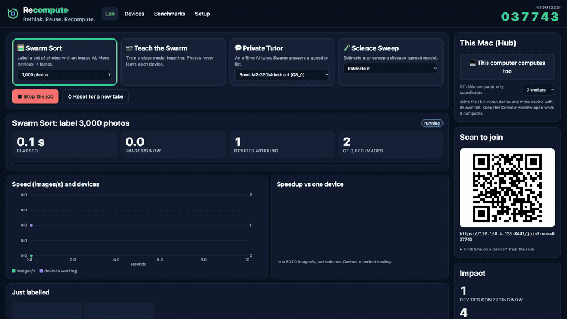
</p>

> Screenshots and the animation come from the real app, captured during a test run with simulated devices (several headless browsers on one computer). They show what the screens look like, not how fast any real device is.

## How it works

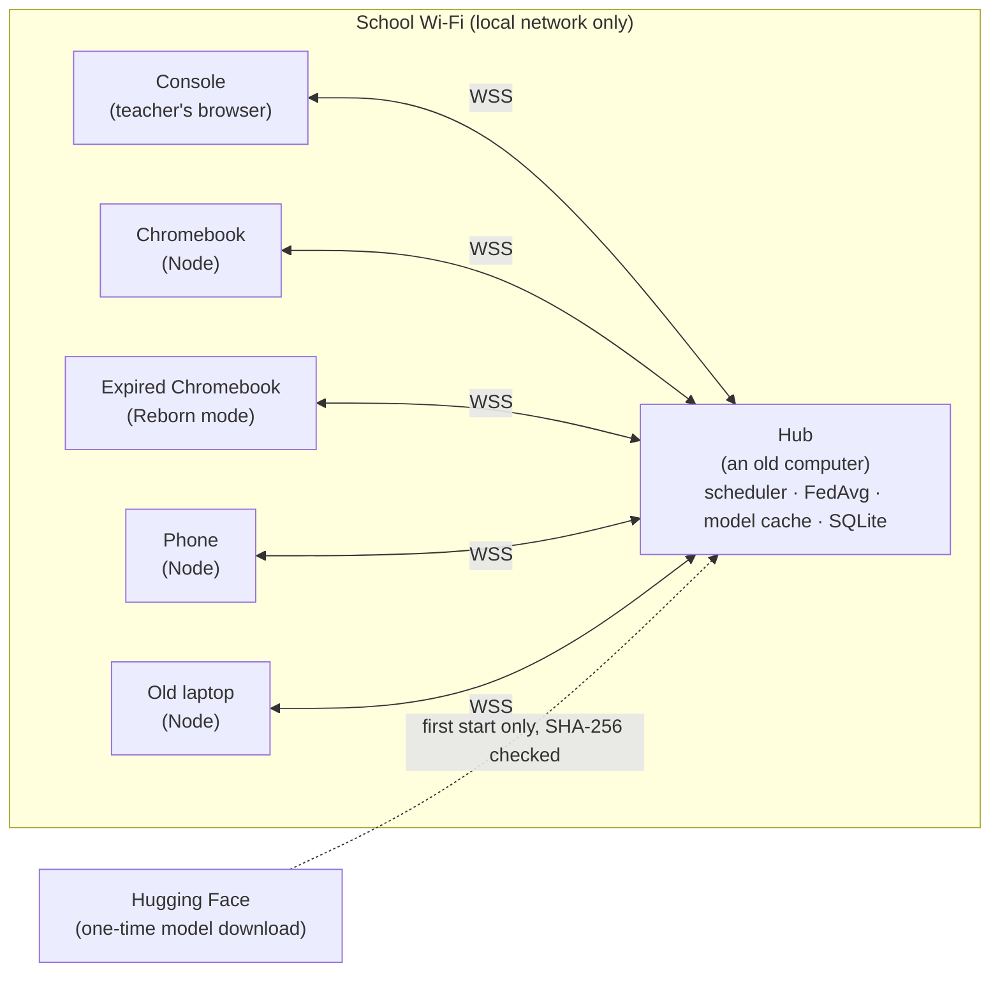

- **Hub:** a Node.js/TypeScript server. It hands out small chunks of work, tracks leases so that no work is lost when a device leaves mid-job, double-checks about 5% of chunks on a second device, averages model updates (FedAvg), and serves cached models over the LAN.
- **Node:** a web page. Devices *pull* work when they're ready (work stealing), so fast and slow devices both help. Chunk sizes adapt to each device.
- **Console:** the teacher dashboard: a join QR code and room code, a live device grid, the Lab launcher, charts, and impact counters.
- **Star topology:** every device talks only to the Hub over WebSocket. There's no peer-to-peer, so it works on networks that block device-to-device traffic, as long as devices can reach the Hub.

## The Labs

| Lab | What students see | What's happening |
|---|---|---|
| **Swarm Sort** | Thousands of photos labeled by the class's devices, with a live images-per-second chart and a speedup chart | Image classification with MobileNetV3 (ONNX Runtime Web, WebAssembly, plus WebGPU when available), split across every device |
| **Teach the Swarm** | Each device photographs objects as *repairable*, *recyclable*, or *battery hazard*; class accuracy rises round by round; the counter reads **"0 photos uploaded"** | Federated learning: each device trains a small classifier on its own photos, and only the weights go to the Hub, which averages them (FedAvg) |
| **Private Tutor** | A chat tutor that works with the internet unplugged, plus a swarm mode that answers a queue of class questions | SmolLM2-360M-Instruct (or Qwen2.5-0.5B-Instruct) running in the browser via llama.cpp WebAssembly (wllama) |
| **Science Sweep** | Monte Carlo π and an SIR epidemic parameter sweep filling in live | Thousands of independent simulations spread across devices |
| **Swarm Render** | One huge picture (up to 7680×4320) of a night-time "circuit city" filling in tile by tile; each tile is outlined in the color of the device that drew it; a **1 device vs all** race | A CPU ray caster in Web Workers; tiles are handed out like any other job, then stitched into a full-size PNG on the Hub |
| **Screen Wall** | Every device's screen becomes one slice of a single picture, in the order you drag them on the Console; a synced RECOMPUTE sweep and a "wake sequence" that lights the screens up one by one | Each device reports its screen size; the Hub lays out the wall (with gaps for bezels) and syncs clocks over WebSocket (NTP-style) so animations line up |
| **Live Captions + Translate** | Huge English captions with a Spanish line underneath, plus the measured delay ("captions ~N s behind") and **"0 seconds of audio saved"**; a *Translate a document* mode | Whisper tiny.en (speech to text) and OPUS-MT en→es (translation) via Transformers.js. Audio is cut into 2–5 s pieces that go to whichever devices are free and come back in order. Audio is held in memory only |

<table>
  <tr>
    <td width="50%">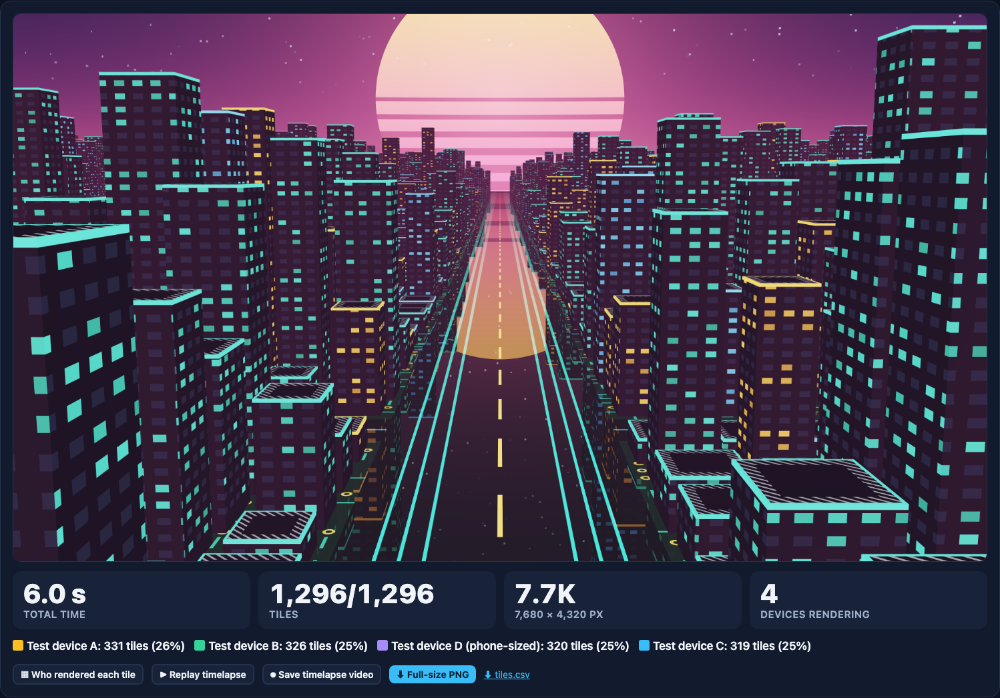<br><sub><b>Swarm Render:</b> one 8K picture, tiles counted per device</sub></td>
    <td width="50%">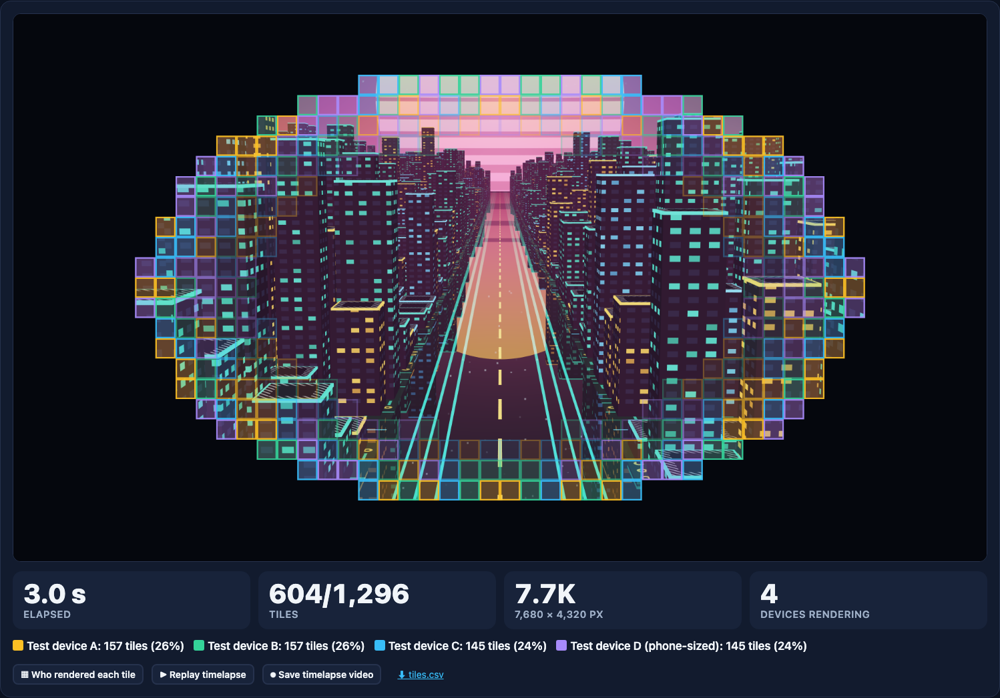<br><sub><b>Swarm Render, live:</b> each tile outlined in its device's color</sub></td>
  </tr>
  <tr>
    <td width="50%">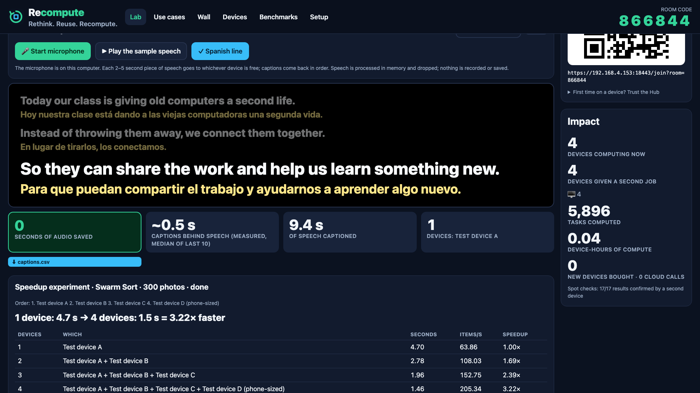<br><sub><b>Live Captions:</b> English + Spanish, measured delay, 0 seconds of audio saved</sub></td>
    <td width="50%">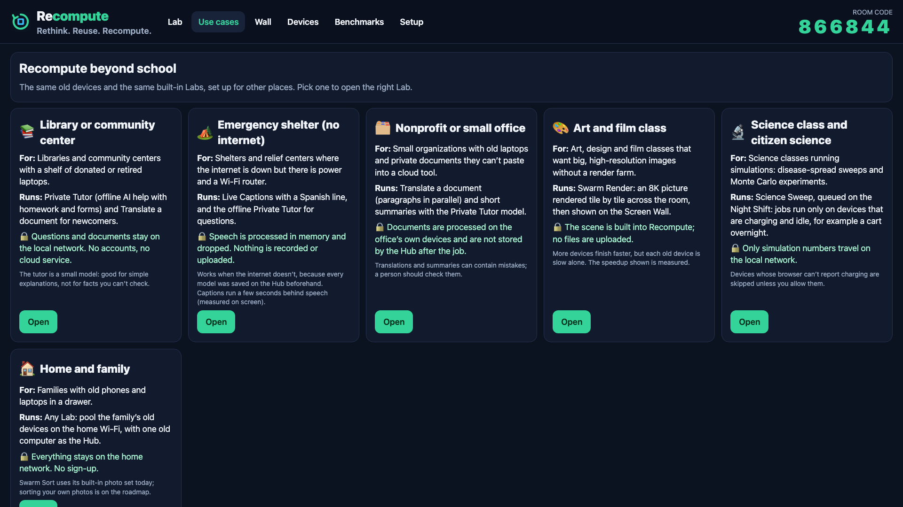<br><sub><b>Use cases:</b> beyond school, Night Shift, and the Fleet calculator</sub></td>
  </tr>
  <tr>
    <td width="50%">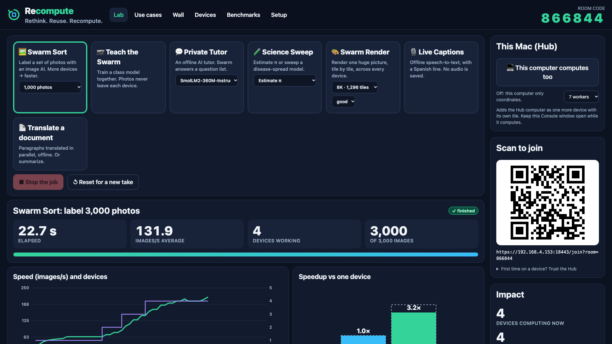<br><sub><b>Swarm Sort:</b> results, live chart, and speedup against a solo run</sub></td>
    <td width="50%">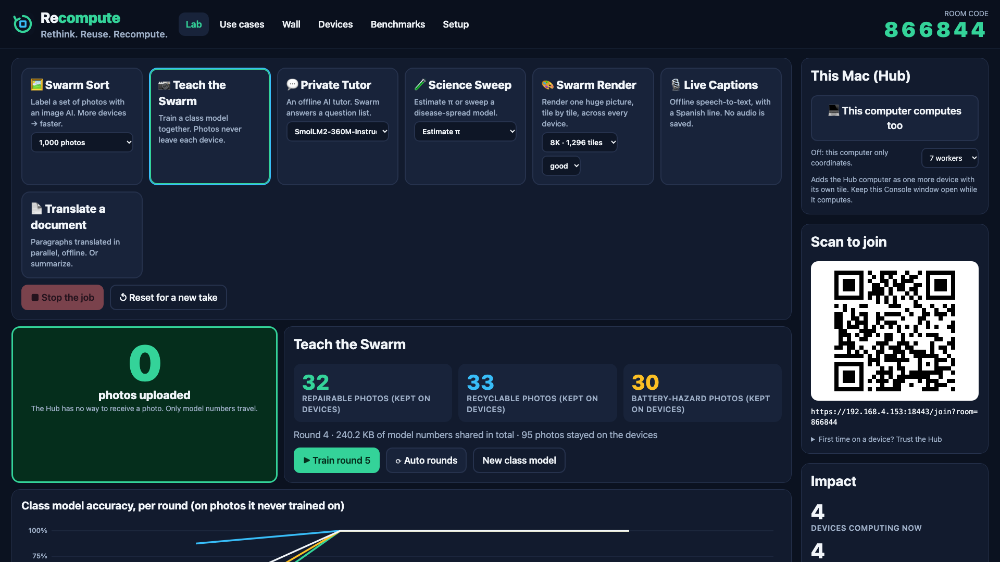<br><sub><b>Teach the Swarm:</b> accuracy per round; photos never leave the devices</sub></td>
  </tr>
  <tr>
    <td width="50%">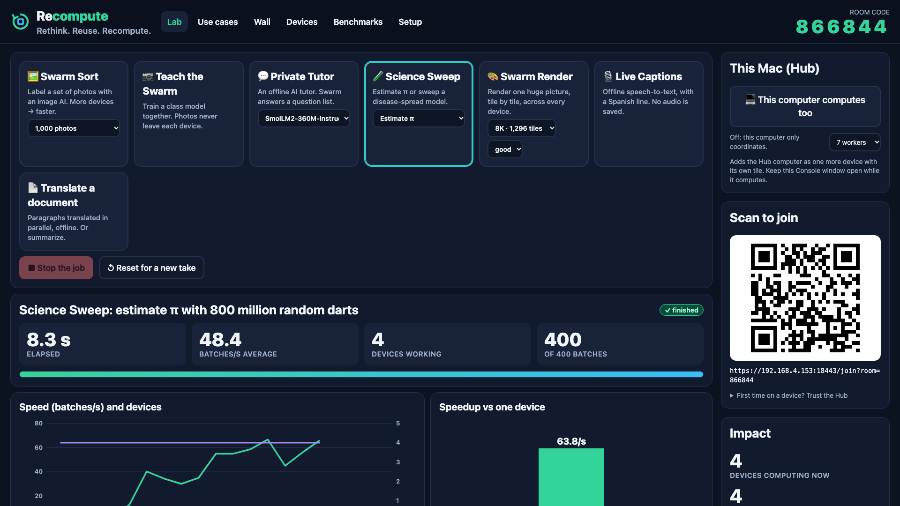<br><sub><b>Science Sweep:</b> Monte Carlo π and SIR sweep</sub></td>
    <td width="50%">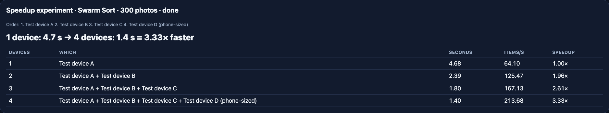<br><sub><b>Benchmarks:</b> automated 1 → N device speedup experiment, exportable as CSV</sub></td>
  </tr>
</table>

<p align="center">
  
</p>
<p align="center"><sub>Screen Wall: four test devices of different sizes showing one continuous picture (captured side by side).</sub></p>

<p align="center">
  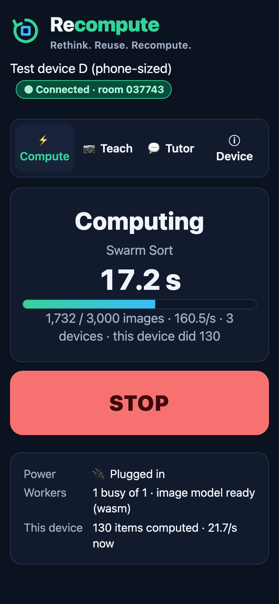
  &nbsp;&nbsp;
  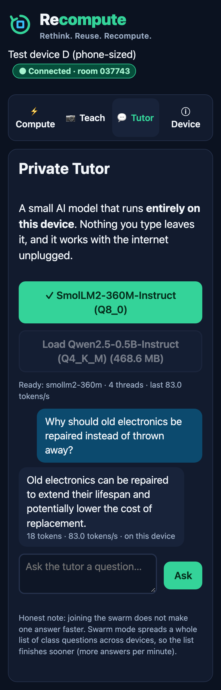
  &nbsp;&nbsp;
  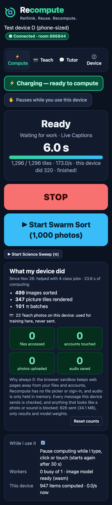
</p>
<p align="center"><sub>Left: a phone computing as a node. Middle: the Private Tutor running offline. Right: "What my device did", with its privacy counters.</sub></p>

## Beyond school: use cases

The Console's **Use cases** tab has a one-screen card for each place where a pile of old devices could do useful work. Each card says who it's for, which Lab it runs, and what stays private. They reuse the same built-in Labs; nothing is simulated.

| Use case | Runs |
|---|---|
| **Library or community center** | Offline Private Tutor and Translate for newcomers |
| **Emergency shelter (no internet)** | Live Captions + Translate and the Tutor: works when the internet doesn't |
| **Nonprofit or small office** | Private document translation, and short summaries with the offline language model |
| **Art and film class** | Swarm Render and the Screen Wall |
| **Science class and citizen science** | Science Sweep as **Night Shift** jobs |
| **Home and family** | Any Lab, pooling the family's old phones and laptops on the home Wi-Fi |

- **Night Shift** queues jobs to run later, one after another, and only on devices that are plugged in and idle: for example, a charging cart overnight.
- **🎬 Film mode** (Console header) runs a hands-free showcase on the joined devices, for a science fair or an open house: the wall wake-up, a render race (one device alone, then all of them), captions, the tutor, Teach the Swarm, a "tap to pause" moment and the use cases, each with a title card. At the end it downloads a zip with the measured results (CSV), the render, and a timestamped chapter log for editing a recording. The Hub only coordinates during a run, so every number comes from the devices.
- **Fleet calculator:** enter a fleet size (one cart of 30, or a whole district's retired devices) and see projected images per hour, render time, and caption-hours. It's labeled *"Projection from measured per-device speed × measured scaling efficiency; real results vary"*, and it shows **nothing** until you've measured your own devices.

## Quickstart (about 5 minutes)

You need one computer to be the Hub (macOS, Windows, or Linux) and devices on the **same Wi-Fi**.

1. **Install [Node.js](https://nodejs.org) LTS** (22.13 or newer).
2. **Get the code and install it:**
   ```bash
   git clone https://github.com/mattjunior039/recompute-lab.git
   cd recompute-lab
   npm install
   ```
3. **Start the Hub:**
   ```bash
   npm run hub
   ```
   The first start downloads the AI models once (about 570 MB, including the speech models for Live Captions) and checks their SHA-256 fingerprints. When it prints **"Models ready"**, Recompute works with the internet unplugged.
4. **Open the Console** on the Hub computer at **http://localhost:8080/console**. It shows a big QR code and a 6-digit room code.
5. **Join devices** by scanning the QR code. The first time on each device, trust the Hub's certificate (about 2 minutes, see [docs/trust-certificate.md](docs/trust-certificate.md)), or use the basic http address if you're short on time.
6. Pick a Lab on the Console and press start. To let the Hub computer help too, click **💻 This computer computes too** (it's never counted in measured results, so speedups always describe the joined devices).

Press **Ctrl+C** in the terminal to stop the Hub. All Hub data (models, certificates, database) lives in the `.recompute/` folder; delete it to start completely fresh.

## Join mode and Reborn mode

| | **Join mode** (default) | **Reborn mode** (`&mode=reborn`) |
|---|---|---|
| For | A student's everyday device | Old or expired devices in a charging cart |
| Screen | Device status, the Labs, and the student's camera and tutor | Full-screen, compute-only status display |
| How | Scan the Console's QR code | Add `&mode=reborn` to the join link (shown under **Setup**) |

Expired Chromebooks keep working as compute nodes in Reborn mode. For owned, already-expired devices, an optional Linux reflash guide is in [docs/reborn-r2-linux.md](docs/reborn-r2-linux.md). It's never required and comes with clear safety caveats.

## Built-in safety

- Each device uses **all CPU cores but one**, so it stays responsive.
- **Pauses while you use it:** in Join mode a device stops computing the moment its owner types, clicks, or touches the Recompute page, and starts again after 30 seconds idle. A chip on the screen shows the state, with a **Resume now** button. Reborn mode is compute-only and doesn't pause.
- **Charge-only:** devices compute only while plugged in where the browser reports charging (Chrome/ChromeOS), with a big "⚡ Charging — computing" / "Paused — unplugged" chip. Where it can't (Safari), the page says the state is unknown rather than guessing.
- **Thermal backoff:** if chunks start taking longer, the device slows down.
- A big **STOP** button on every device, and Stop-all on the Console.
- **Local-first:** if the Hub disappears, a device that already has the models can keep running a Lab on its own.

## Privacy and security

- **No accounts, no names, no analytics, no telemetry.** Nothing is sent outside your network during lessons.
- **"What my device did":** every device shows the jobs it helped with, what it processed (images, tiles, audio pieces), its compute time, and a privacy block: **0 files accessed · 0 accounts touched · 0 photos uploaded · 0 audio saved**. Those zeros hold by design: the browser sandbox keeps web pages away from files and accounts, Recompute has no file picker or sign-in, and every message a device sends is checked, so anything that looks like a photo or a sound is blocked.
- **LAN only:** the Hub serves everything itself. The internet is needed only for `npm install` and the one-time model download.
- **Photos stay on the device.** Teach the Swarm sends only model weights.
- **Audio is never saved.** Live Captions keeps audio pieces in memory only, long enough to turn them into text, and the Console counts "0 seconds of audio saved".
- **No remote code:** devices run only the compute kernels built into the app. The Hub sends data, never code.
- **Pinned models:** every model is pinned to a fixed version and checked against a SHA-256 hash.
- **Local HTTPS:** the Hub creates its own small certificate authority so browsers allow multi-threaded WebAssembly, the camera and microphone, offline storage, and WebGPU. The CA's private key never leaves the Hub computer.

Found a vulnerability? See [SECURITY.md](SECURITY.md).

## Honest limitations

- **Throughput, not latency.** Pooling devices finishes a *batch* of work sooner (more photos per second, more questions answered). It doesn't make a single chat reply faster.
- **Old devices are slow on their own.** The point is what they can do together. A single old Chromebook running the tutor answers slowly.
- **Only measured numbers.** Recompute shows speeds it actually measured on your devices. This README doesn't claim any device speeds; run the Benchmark page (`/bench`) and the speedup experiment to get your own. The Fleet calculator is a projection from those measurements, and it says so.
- **Captions lag a little.** The caption delay depends on how fast your devices are; the Console shows the measured delay instead of promising one. Each device that helps with captions loads about 165 MB of speech models the first time. Captions are English only, with translation into Spanish.
- **Pause-while-in-use only sees the Recompute page.** A web page can't watch other apps, so it notices typing, clicks, and touches on its own tab.
- **The Screen Wall syncs over Wi-Fi.** Busy networks add jitter; screens line up best on a quiet network.
- **No energy claims.** Recompute never estimates power use. If your school has a plug-in power meter, you can *optionally* enter measured watts per device under **Console → Benchmarks**, and energy per job is then calculated from those readings only.
- **Same network required.** Devices must be able to reach the Hub. Some school SSIDs isolate clients; see the [IT admin guide](docs/it-admin-guide.md).
- **iPhones and iPads pause background tabs.** Keep the Recompute page open with the screen on.
- Recompute is a classroom learning tool, not a production compute cluster.

## Documentation

| Guide | For |
|---|---|
| [Teacher guide](docs/teacher-guide.md) | Running a 45-minute Lab, aligned to the AI4K12 Five Big Ideas |
| [IT admin guide](docs/it-admin-guide.md) | Network, Google Admin console policies, certificates, AUE and Reborn guidance, battery safety |
| [Trusting the certificate](docs/trust-certificate.md) | Step-by-step for ChromeOS, iOS, macOS, Windows, and Android |
| [Reborn R2: Linux on expired Chromebooks](docs/reborn-r2-linux.md) | Optional, advanced, with safety caveats |
| [Licenses](docs/licenses.md) | Third-party models, dataset, and libraries |

## Roadmap

- Sorting your own photo folders in Swarm Sort (today it uses the built-in photo set)
- More caption and translation languages
- More Labs and more measured benchmark data from real classroom devices
- Translations of the Console and the guides

Ideas and classroom feedback are welcome; see [CONTRIBUTING.md](CONTRIBUTING.md). Pause-while-in-use and the "What my device did" panel were added after feedback from students.

## Contributing

Bug reports, classroom stories, measured benchmark numbers, and pull requests are all welcome. Start with [CONTRIBUTING.md](CONTRIBUTING.md) and the [Code of Conduct](CODE_OF_CONDUCT.md). To run the tests:

```bash
npm test
npm run typecheck
```

## License and credits

Recompute is released under the [MIT License](LICENSE). Third-party models (MobileNetV3, SmolLM2, Qwen2.5, Whisper tiny.en, OPUS-MT en→es), the Caltech 101 image subset (CC BY 4.0), and libraries keep their own licenses; see [docs/licenses.md](docs/licenses.md). The Swarm Render city is generated by code in this repository.

**AI-assistance disclosure:** Software built with AI coding assistants from the author's design; the idea and research are the author's.
